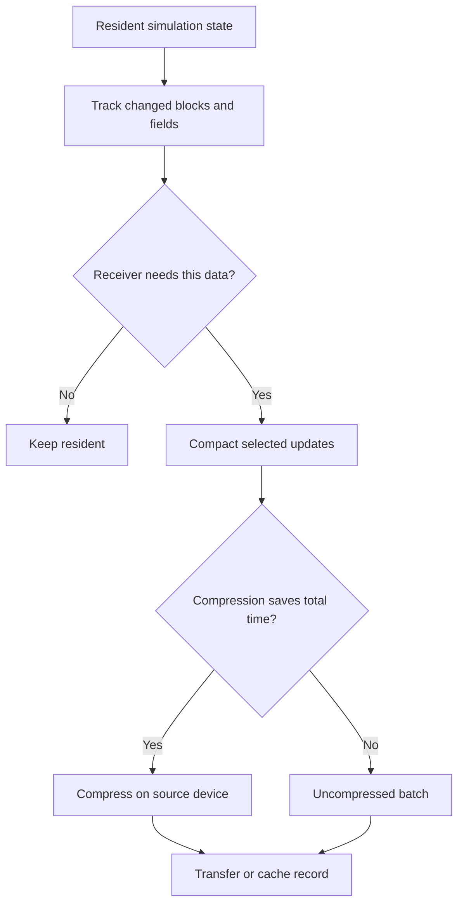
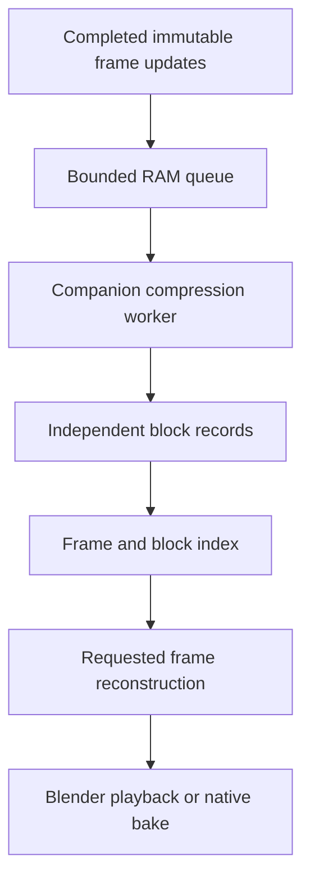

# Compression methods

## Goal and constraints

Reduce RAM/VRAM usage, CPU–GPU traffic and cache I/O while supporting responsive Blender scrubbing. This is a candidate assessment, not a measured performance claim. [Scope](../scope.md) is authoritative.

**GPU arithmetic requirement:** Use the highest hardware-accelerated floating point method supported by the detected GPU.

Compression describes storage and transport separately from arithmetic. Packed data may be decoded into the selected floating point type for computation. Lossy storage still introduces error even when decoded into a wider type.

| Mode | Compression role |
| --- | --- |
| Hybrid | Keep CPU precision and GPU bulk state resident; exchange changed boundary data and corrections only. |
| GPU-only preview | Keep all simulation state on the GPU; no CPU precision exchange. Read back only data required for playback, caching or control. CPU cache work is permitted. |

## Pipeline

Dirty tracking and active-region scheduling are not codecs. They avoid sending and computing unnecessary data before compression begins. Detect changes where state is updated; do not download the domain to compare it on the CPU.

## Viable methods

| Method | CPU use | GPU use | Assessment |
| --- | --- | --- | --- |
| Changed-field masks and sparse block records | Track active precision blocks and encode updates | Generate flags and compact updates in device memory | Baseline. Switch to dense block records when most entries change. |
| Integer delta coding and bit packing | Stable IDs, sorted neighbour indices, flags | Parallel packing of indices and cluster references | Lossless baseline for integer metadata. Retain exact IDs and counts. |
| Temporal XOR plus lossless codec | Frame differences and checkpoints | Form XOR differences before readback | Candidate for exact floating point reconstruction. XOR bit patterns; ordinary floating point subtraction/addition is not guaranteed bit-exact. |
| Shuffle/bitshuffle plus LZ4 or Zstandard [1–3] | RAM cache, background writer and checkpoints | GPU equivalents require a compatible implementation | First CPU codec candidates. Shuffle is reversible preprocessing, not compression alone. Test LZ4 for latency and Zstandard for storage savings. |
| Compressed neighbour lists [4–5] | Band et al. SPH list representation | Thaler/Keller clustered lists for NVIDIA and AMD | Strong compute-memory candidate. Decode near traversal; do not transfer the full list each frame. |
| ZFP [6] | Random-access compressed arrays and numerical cache blocks | Supported backend/mode combinations for block codecs | Strongest for grid fields and SDFs. Test spatially ordered particle arrays separately. Fixed-rate random access is distinct from fixed-accuracy or reversible modes. |
| ndzip / ndzip-gpu [7] | Lossless numerical blocks and exact checkpoints | GPU compression before transfers | Candidate for correlated floating point arrays. Published grid results do not establish performance on sparse particle updates. |
| nvCOMP [8] | Decode compatible formats with an appropriate CPU decoder | NVIDIA batch compression/decompression | Optional NVIDIA acceleration, not the cross-vendor baseline. Verify framing, codec compatibility and installed-version capabilities. |
| Quantized storage: QuanTaichi and automatic quantization [9–10] | Compact inactive state or playback data where error is allowed | Packed particle fields decoded for arithmetic | Conditional lossy option. Does not replace the required GPU floating point selection. Gate on an explicit error budget. |
| Progressive particle hierarchy [11] | Indexed preview reconstruction | GPU decoding would require separate implementation validation | Playback candidate, not the initial hot solver state. Preserve IDs and attributes alongside position coding. |

General-purpose compressed byte streams cannot normally be used directly by arithmetic kernels. Keep hot working blocks decoded, or use a deliberately designed packed representation with local decoding. Count scratch buffers and duplicate representations in memory measurements.

## Recommended starting choices

| Data | Initial candidate | Alternative to benchmark |
| --- | --- | --- |
| CPU precision working set | Native floating point arrays; lossless transport | Compressed inactive blocks with a decoded working cache |
| GPU working set | Resident arrays, packed flags/IDs, compressed neighbour lists | Quantized storage only after error validation |
| Small boundary exchange | Compact uncompressed records | Lossless compression when measured beneficial |
| Large numerical exchange | Lossless block codec | ndzip-gpu or compatible nvCOMP path on supported GPUs |
| SDF/grid storage | Independent ZFP blocks, with conservative error handling | Lossless blocks for precision-critical fields |
| Interactive frame cache | Independent LZ4 blocks with shuffle or temporal XOR | Zstandard, ZFP or progressive playback representation |
| Restart checkpoints | Lossless complete solver state | Block compression and reuse of unchanged records |

Lossy SDF storage must not hide contacts: account for its error in collision bounds and use sufficient accuracy in the contact solve. Keep precision-owned authoritative state lossless in the initial design.

## Transfer rules

- Keep persistent copies only where needed; record ownership and versions.
- Separate physics, viewport and cache update streams. GPU-only preview removes the physics exchange, not necessarily viewport/cache readback.
- Batch contiguous records rather than issuing a transfer per particle.
- Use source-side compression: CPU compression after a full GPU readback cannot save that readback's bandwidth.
- Benchmark both directions, including compression, synchronization, transfer and decoding. Bypass compression for small or incompressible batches.
- Use asynchronous transfers and reusable staging buffers where supported [12]. Synchronize dependent boundary solves; overlap only independent work.
- Include births, removals, migrations, attribute changes and mode changes in metadata. Sorting alone must not appear as particle motion.

## Indexed cache

- Store an initial state and periodic block keyframes; unchanged blocks reference their previous version.
- Bound temporal delta chains. Independent compression blocks alone do not remove dependencies between delta frames.
- Each record identifies run, frame, block, base version, codec, field layout, precision/quantization parameters, sizes and checksum.
- Use reconstructed bases consistently for lossy deltas, and bound accumulated error. Lossless XOR deltas reproduce the original bit patterns.
- Batch disk writes and publish only complete records. Apply backpressure during baking rather than discard frames.
- Retain recently reconstructed frames in RAM and prefetch near the playhead. Keep exact checkpoints separate from optional reduced-quality preview records.
- Blender native baking remains a conversion through Blender, not a promise that it accepts this cache format.

## Acceptance checks

Measure end-to-end frame time, CPU/GPU compression cost, transfer bytes, peak memory including scratch space, compression ratio and random-seek latency. Test sparse and fully moving scenes, mixed radii, contact-heavy boundaries and incompressible data.

Lossless paths must reconstruct bit-exactly. Lossy paths need position/contact and long-run error tests against a higher-precision reference. Benchmark hybrid and GPU-only preview separately on supported hardware. No codec is selected solely for its compression ratio.

## References

1. [Blosc: shuffle, bitshuffle and codec composition](https://blosc.org/pages/blosc-in-depth/) and [chunk format](https://blosc.org/c-blosc2/format/chunk_format.html).
2. [LZ4](https://lz4.org/) and [independent block format](https://github.com/lz4/lz4/blob/dev/doc/lz4_Frame_format.md).
3. [Zstandard](https://github.com/facebook/zstd).
4. Band, Gissler and Teschner, [Compressed Neighbour Lists for SPH](https://doi.org/10.1111/cgf.13890), 2020. CPU results; GPU performance must be assessed separately.
5. Thaler and Keller, [GPU-Native Compressed Neighbor Lists with a Space-Filling-Curve Data Layout](https://arxiv.org/html/2602.19873v1), 2026. GPU clustered-list approach.
6. Lindstrom, Fixed-Rate Compressed Floating-Point Arrays, 2014; [ZFP project and implementation](https://computing.llnl.gov/projects/zfp). Confirm backend and compression-mode support for the pinned release.
7. Knorr, Thoman and Fahringer, [ndzip-gpu](https://sc21.supercomputing.org/proceedings/tech_paper/tech_paper_pages/pap595.html), 2021; [implementation](https://github.com/celerity/ndzip).
8. [nvCOMP documentation](https://docs.nvidia.com/cuda/nvcomp/). NVIDIA-specific acceleration; availability is codec/version dependent.
9. Hu et al., [QuanTaichi: A Compiler for Quantized Simulations](https://mingkuan.taichi.graphics/publication/2021-quantaichi/), 2021.
10. Liu et al., [Automatic Quantization for Physics-Based Simulation](https://arxiv.org/abs/2207.04658), 2022.
11. Hoang et al., [Progressive Tree-Based Compression of Large-Scale Particle Data](https://hoang-dt.github.io/), published online 2023, TVCG 2024.
12. [CUDA best practices: transfers and overlap](https://docs.nvidia.com/cuda/archive/12.8.0/cuda-c-best-practices-guide/). Apply equivalent backend facilities where available.

Assessments combine published methods and project-specific design proposals. Source papers are not stored in this repository.
