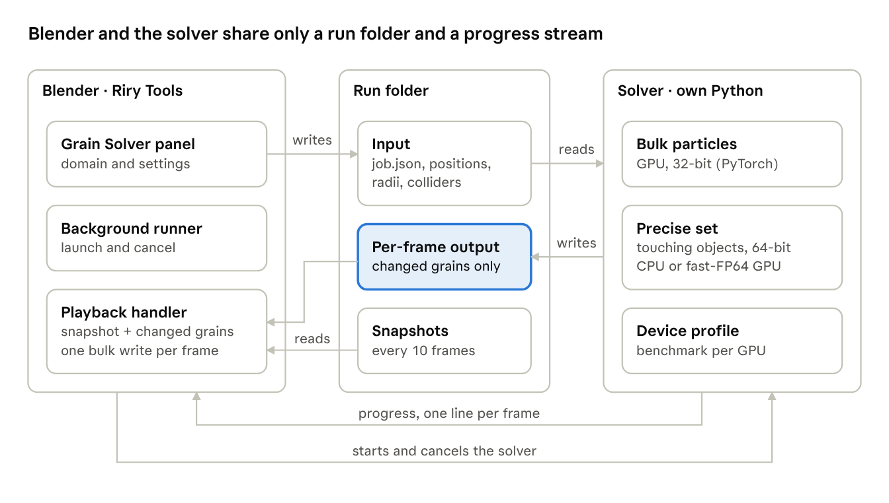

# Riry Grain Solver — Concept Sheet

Nov 18, 2026 · @Riry

A standalone Python solver, run by Riry Tools as a separate process, simulates sand-like grains on the GPU (NVIDIA CUDA or AMD ROCm, with a CPU fallback) inside a domain box you place, and hands back only the grains that moved each frame.

## Goals and non-goals

The solver must run the same Python code on Windows, Linux and macOS, use whatever GPU the machine has, and never block or crash Blender.

**Goals**

- Simulate 50k–500k spherical grains that pour, pile and slump like sand or gravel, with a stable angle of repose.
- Simulate only grains inside a domain object; grains just outside it act as fixed obstacles.
- Collide with mesh obstacles inside the domain.
- Return, per frame, the original indices of grains that moved, with their new positions and velocities.
- Run as a separate Python process with its own GPU libraries, launched and cancelled from the Riry Tools panel.
- Fall back to the CPU, with the same code, when no supported GPU is found.

**Non-goals for version 1**

- Non-spherical grains (clumps of spheres come later, if at all).
- Liquids and semisolids in version 1: they come in phase 2 (see Materials and precision).
- Two-way coupling with rigid bodies: colliders push grains, grains do not push colliders.
- Real-time viewport interaction: it is a bake-style tool.

## Architecture

Blender never imports PyTorch: it writes the run folder, starts and cancels the solver, and plays back only the grains each frame changed. A solver crash or GPU memory error therefore stops the run, not Blender.

## GPU backend

Use PyTorch: it is the only library here where one code path runs on NVIDIA (CUDA), AMD (ROCm), the CPU and Apple GPUs. ROCm builds of PyTorch expose AMD cards through the same `torch.cuda` device API, so the solver never branches on vendor.

| Library | NVIDIA (CUDA) | AMD (ROCm) | CPU, same code | macOS | Fit for this solver |
| --- | --- | --- | --- | --- | --- |
| **PyTorch** (recommended) | Yes, all OSes | Linux: official. Windows: AMD preview wheels since ROCm 6.4.4 (Sept 2025), RX 7000/9000 and Ryzen AI only | Yes | CPU and Metal (MPS) | Has every operation needed: sort, binary search, gather, scatter-add. Large install (about 2–3 GB with CUDA) |
| CuPy | Yes | Linux wheels; Windows unclear | No (NumPy is a separate path) | No | NumPy-style; custom kernels in CUDA C |
| Taichi | Yes | Experimental AMDGPU backend; AMD works through Vulkan instead | Yes | Metal (Tier 2) | Best kernel language for particles; the project's release pace has slowed |
| NVIDIA Warp | Yes | No | Yes | CPU only | NVIDIA only |
| Numba | Yes | No (ROCm target dropped) | Yes | CPU only | NVIDIA only |

AMD on Windows is the weak spot: ROCm there is a subset of the Linux stack and the PyTorch wheels cover a short GPU list. To keep that from blocking anyone, the solver hides its math behind a small backend interface (about six array operations). PyTorch is the only backend in version 1; a Taichi backend on Vulkan can be added later if AMD Windows users fall outside AMD's list.

Support details above come from search results, not opened pages (the reference sites were not reachable). Check them before the build starts.

## Solver

The solver is position-based dynamics (PBD) with many small substeps and one constraint pass each, following Macklin et al. 2014 for granular friction and Macklin et al. 2019 for substepping. Every step is a whole-array GPU operation, so there is no per-grain Python loop.

**Each frame**

1. Rebuild the contact list (below) if any grain has moved more than half the search margin since the last build.
2. Run 8–20 substeps of length 1 / (fps × substeps).
3. Mark grains as changed, update sleep counters, and write the frame's output.

**Each substep**

1. **Predict:** awake grains get velocity + gravity × dt, then a predicted position. Speed is capped so no grain moves more than half its radius per substep.
2. **Grain contacts:** for each candidate pair closer than the sum of radii, compute the overlap and push the pair apart along the line between them, split by inverse mass. Pushes are summed per grain with a scatter-add, divided by that grain's contact count, and scaled by a relaxation factor (1.0–1.5, tuned in testing).
3. **Friction:** at each contact, take the sideways part of the pair's relative movement this substep. If it is below static friction × overlap, cancel it (the grains stick); otherwise reduce it by kinetic friction × overlap. This is what gives a pile its slope.
4. **Colliders:** sample each collider's signed distance field (SDF) at the grain. Inside or within one radius, push out along the field's gradient and apply the same friction rule. Animated rigid colliders work by moving the sample point into the collider's rest space with its world matrix, so the SDF is built only once.
5. **Update velocity** from the position change, apply light damping, and wake any sleeping grain that received a push larger than a small threshold.

**Neighbour search** (rebuilt per frame, not per substep)

- Cell size = the largest grain diameter plus a margin. Each grain gets a cell key from its position.
- Sort grains by key, then find each cell's first and last grain with a binary search on the sorted keys.
- For each of the 13 forward neighbour cells plus its own cell (half of the 27, so each pair is found once), gather up to K grains per cell and keep pairs within diameter + margin.
- Loop over the 14 offsets in Python, one GPU batch each, so memory stays at N × K per batch instead of N × 27 × K.
- With a margin of about one radius, the list stays valid for a whole frame for typical speeds.

**Sleeping:** a grain whose speed stays under a threshold for 10 frames sleeps. Sleeping grains skip prediction but still push back in contacts, so a settled pile costs only its contact checks.

**Collider fields:** at the start of a run the solver builds a narrow-band SDF for each collider on a voxel grid half a grain radius wide, from the triangles Blender sends. Sampling is trilinear; the gradient gives the push direction.

## Materials and precision

Phase 2 adds liquids and semisolids to the same particle engine. Bulk particles run on the GPU in 32-bit; particles touching a collider or another object are solved in 64-bit, on the CPU when the GPU's 64-bit speed is poor. Each GPU gets settings tuned by a short benchmark, but positions never drop below 32-bit.

**Materials** (a per-particle `material.npy`, uint8, added to the data contract)

| Material | Method | Phase |
| --- | --- | --- |
| Granular (sand, gravel) | PBD contacts with static and kinetic friction | 1 |
| Liquid (water) | Position Based Fluids (Macklin and Müller 2013): a density constraint per particle, XSPH viscosity, cohesion for surface tension | 2 |
| Semisolid (mud, slime, dough) | The liquid method with high viscosity and stronger cohesion; plasticity to be decided | 2 |

All three share the neighbour search, colliders, sleeping, cache and changed-index output.

**Precise solving for particles that touch something**

1. Each substep, mark a particle as precise if it is within one radius of a collider surface or in contact with a particle of another object or material.
2. Add one ring of neighbours around the marked set as a halo, so forces at the edge of the set use current values on both sides.
3. Solve the bulk on the GPU in 32-bit. Copy the precise set and its halo to the precise device, solve them in 64-bit, and copy back only the precise particles; the halo copies are discarded.
4. The precise device is the CPU on consumer cards, whose 64-bit maths runs at 1/32 to 1/64 of their 32-bit rate. On cards with fast 64-bit (data-centre NVIDIA and AMD Instinct parts) it stays on the GPU. The benchmark decides; the panel offers Auto, CPU, GPU or Off.
5. The cost is two small transfers per substep, about 40 per frame at 20 substeps. That is cheap while the precise set is a small share of all particles; phase 2 testing measures where it stops paying off, and the panel shows the precise count per frame.

**What "no rounding deviation" can and cannot mean**

- **Same machine, same settings:** results are bit-identical on every run. This needs the per-grain sums done in a fixed order (sort, then sum each grain's run) instead of GPU atomic adds, which add in a random order. Deterministic mode is on by default and costs a little speed.
- **Different machines, or CPU against GPU:** results differ in the last bits, because hardware fuses multiply-adds differently and uses different math libraries, and a chaotic pile turns those bits into visible differences after a few hundred frames. No setting prevents this; the baked cache is the reference to share.
- **Large worlds:** positions are stored relative to the domain's centre, so 32-bit resolution depends on the domain's size, not on its distance from the world origin.

**Per-GPU tuning, and why not FP8 or FP16**

Low-precision formats speed up neural-network matrix maths on tensor cores. This solver does no matrix maths: it is limited by memory traffic and needs fine position steps. The step between neighbouring values near 1 m shows the problem:

| Format | Step near 1 m | Usable for positions? |
| --- | --- | --- |
| FP8 (e4m3) | 125 mm | No |
| bfloat16 | 7.8 mm | No |
| FP16 | 0.98 mm | No: each step is about the whole radius of a 1 mm grain |
| FP32 | 0.00012 mm | Yes, the bulk default |
| FP64 | far below 1 nm | Yes, the precise set |

What the solver tunes per GPU instead:

- **Read from the driver:** device name, architecture (NVIDIA compute capability or AMD gfx target), memory size and core count. These key the saved profile and show in the panel.
- **Measured by a 10–20 second benchmark** at install and whenever the GPU or driver changes: 32-bit and 64-bit throughput, memory bandwidth, CPU–GPU transfer time and free memory.
- **Chosen from the profile:** where the precise set runs, neighbour batch sizes and slots per cell, how many particles fit per batch, and whether compiled kernels (`torch.compile`, mostly on Linux) beat plain PyTorch.
- **16-bit storage** is allowed only for data that is not physics, such as colour or age.

## Data contract

Blender and the solver talk through a run folder of plain NumPy `.npy` files plus one `job.json`, so both sides read and write arrays without copying, and a run can be inspected or replayed by hand.

**Input, written by Blender**

| File | Contents | Type and shape |
| --- | --- | --- |
| `job.json` | Format version, frame range, fps, substeps, gravity, friction, sleep settings, device choice, domain matrix and per-face wall mode | JSON |
| `index.npy` | Original point index in the Blender object for each grain sent | uint32, N |
| `position.npy` | World-space positions | float32, N × 3 |
| `velocity.npy` | World-space velocities (zero for a fresh pour) | float32, N × 3 |
| `radius.npy` | Grain radii | float32, N |
| `role.npy` | 0 = simulated, 1 = fixed halo obstacle | uint8, N |
| `collider_N_tris.npy` | One collider's rest-space triangles | float32, T × 3 × 3 |
| `collider_N_matrix.npy` | That collider's world matrix per frame | float32, F × 4 × 4 |

**Output, written by the solver**

| File | Contents | Type and shape |
| --- | --- | --- |
| `frame_0012.npz` (one per frame) | `index`: original indices of changed grains; `position`; `velocity` | uint32 M; float32 M × 3; float32 M × 3 |
| `final.npz` | Every simulated grain's last state, for resuming | as input |
| stdout | One JSON line per frame: frame, changed count, awake count, seconds | text |

**Which grains are sent**

- Grains whose centre is inside the domain box (in the domain object's own space, so it can be rotated) are simulated.
- Grains outside it but within two of the largest diameters are sent as fixed obstacles, so grains at the edge have something to lean on.
- Everything else stays in Blender untouched.
- Each domain face is either a solid wall (default) or open. A grain that leaves through an open face is reported once and then stops simulating.

**The changed rule:** a grain is reported when it is more than 1% of its radius away from the position last reported for it, not from the previous frame. Slow creep therefore adds up and is reported eventually, and Blender's copy never drifts from the solver's.

**Versioning:** `job.json` carries a format number. The solver refuses a format it does not know, and Blender refuses output whose format or run ID does not match the run it started.

## Blender side

A new **Grain Solver** section under Riry Tools sets up the run, starts the solver in the background, and plays the results back from the cache. Blender's own Python never imports PyTorch.

**Panel**

- Grain object: a point cloud or mesh vertices; radius from a `radius` attribute or one uniform value.
- Domain object: an empty or box; its faces' wall modes.
- Colliders: one collection of meshes, static or with animated transforms.
- Settings: frame range, substeps, gravity, static and kinetic friction, sleep threshold.
- Device: Auto, GPU, or CPU, with the device the solver found shown underneath (for example "AMD Radeon RX 7900 XTX (ROCm)").
- Buttons: Install solver, Simulate domain, Cancel, Clear cache.

**Running**

- Simulate domain writes the run folder, then starts the solver's own Python as a separate process.
- A timer reads its progress lines, so Blender stays usable and shows a progress bar. Cancel stops the process; frames already written are kept.
- The solver loads the GPU libraries; if it crashes or runs out of GPU memory, Blender reports the error and nothing in the scene changes.

**Cache and playback**

- The run folder lives next to the .blend (`//riry_grain_cache/<object>/`); an unsaved file uses a temporary folder and the panel warns.
- Every 10 frames the solver also writes a full snapshot of all simulated grains.
- On frame change, a handler loads the nearest snapshot at or before that frame, applies the changed grains of each later frame, and writes the positions to the object in one bulk call. Scrubbing backwards therefore costs at most 9 small files.
- A Bake button can later turn the cache into a self-contained Geometry Nodes bake; that is not in version 1.

**Installing the solver**

- Install solver creates a separate Python environment in the add-on's user folder, using the Python that ships with Blender, so nothing touches Blender's own packages.
- It picks the PyTorch build from the hardware it finds: NVIDIA → CUDA wheels; AMD on Linux → ROCm wheels; AMD on Windows → AMD's preview wheels, if the card is on AMD's list; Mac → the standard build (Metal); otherwise → CPU. The panel shows the choice and allows an override.
- The download is about 2–3 GB, so it happens once, on request, never at add-on install. The add-on's manifest must declare network access.

## Performance and testing

Target: 200k grains at 20 substeps in under 1 second per frame on a mid-range GPU (RTX 4070 or RX 7800 XT class), and 50k grains in under 5 seconds per frame on an 8-core CPU. These are goals to confirm in the phase 1 benchmark, not measurements.

**Limits**

- GPU memory: about 200 bytes per grain plus the contact list, so 1 million grains needs roughly 1 GB.
- Spheres only; mixed radii up to about 4:1 before the neighbour cells get too crowded.
- A tall pile needs more substeps: a pile N grains high needs roughly N/2 substeps to settle without sagging.
- Fast objects: a collider moving more than one grain radius per substep can pass through grains; the panel warns when an animated collider is that fast.

**Tests**

1. **Unit tests of the solver alone, on the CPU**, so they run in CI on any machine: two grains stop at exactly touching distance; a grain on a slope sticks below the static-friction angle and slides above it; nothing overlaps by more than 1% of its radius after settling.
2. **Settling test:** 20k grains poured on a plate form a cone whose slope matches the friction setting to within 3 degrees, and stay still for 100 frames with sleeping on.
3. **Determinism test:** two runs with the same settings on the same device give bit-identical output files.
4. **CPU against GPU test:** the same small scene on both devices stays within a set distance for 50 frames (equal results are not expected).
5. **Precise-set test (phase 2):** particles touching a collider match a full 64-bit reference run to within 32-bit error, while the bulk stays in 32-bit.
6. **Domain test:** grains outside the domain are never written; halo grains never move; indices in the output always refer to the original object.
7. **Blender round trip, headless on 5.1:** write a run folder, run the solver on the CPU, play back frames 1–30 forwards and backwards, and get the same positions both ways.

GPU tests need real hardware, so they run on your machine or a GPU CI runner.

## Build phases and open questions

1. **Phase 1 — granular solver:** the solver package with the CPU backend first, the data contract, unit and settling tests, then the PyTorch GPU path and the benchmark profile.
2. **Phase 1 — Blender module:** the Grain Solver panel, installer, background run, cache and playback, tested headless on 5.1.
3. **Phase 2 — liquids and semisolids:** Position Based Fluids, viscosity and cohesion, then the precise 64-bit set for particles touching objects.
4. **Phase 3 — extras:** a Geometry Nodes bake, a Taichi on Vulkan backend for AMD cards outside AMD's Windows list, and clumped (non-spherical) grains if still wanted.

**Open questions**

- [ ] Which GPUs do you and your testers have? This decides which install paths get tested first.
- [ ] Does "touching something" include only colliders and other objects, or also particles of the same object that collide hard?
- [ ] Should semisolids hold their shape (plasticity, like clay) or only flow slowly (viscosity, like mud)?
- [ ] Is a 2–3 GB one-time solver download acceptable for your users, or should a smaller CPU-only install be the default?
- [x] Should the solver live in the Riry Tools repository or in its own repository with its own releases? **Its own repository: OpenGrainSim.**

## Formulas

All 84 formulas the solver may use, sorted by purpose and solving method, are in [formula-catalogue.md](formula-catalogue.md) (the *Formula catalogue* tab of the doc); the full formulas and sources are in [formulatable.md](formulatable.md).

## Reading list

One extract per reference, with its key equations and takeaways, is in [extracts/](extracts/README.md).

Twenty-eight references in five groups: tearing, FLIP and granular liquids, bearing and shear forces, plus GPU neighbour search and floating-point precision, the two areas this solver depends on most. Each was confirmed through search on the as-of date; links go to author or publisher copies.

### Tearing of bread, meat and soft materials

The material point method (MPM) work from Jiang's group is the closest match for tearing food; the mesh-based papers explain the older crack-splitting approach it replaced.

| Reference | Year | What to take from it |
| --- | --- | --- |
| [CD-MPM: Continuum Damage Material Point Methods for Dynamic Fracture Animation](https://par.nsf.gov/servlets/purl/10108350) — Wolper, Fang, Li, Lu, Gao, Jiang | 2019 | Tearing bread and other organic materials on particles without splitting a mesh; damage grows from an energy model. Code: [ziran2019](https://github.com/squarefk/ziran2019) |
| [AnisoMPM: Animating Anisotropic Damage Mechanics](https://par.nsf.gov/servlets/purl/10180979) — Wolper, Chen, Li, Fang, Qu et al. | 2020 | Raw meat that tears along its muscle fibres; fibre direction is stored per particle. Code: [ziran2020](https://github.com/penn-graphics-research/ziran2020) |
| [Remeshing-Free Graph-Based Finite Element Method for Fracture Simulation](https://avirupmandal.github.io/fracture-cgf2022) — Mandal, Chaudhuri, Chaudhuri | 2023 | Ductile and brittle fracture on a tetrahedral mesh without remeshing, with a torn loaf of bread as an example |
| [Graphical Modeling and Animation of Ductile Fracture](https://cal.cs.umbc.edu/Papers/Obrien-2002-GMA) — O'Brien, Bargteil, Hodgins | 2002 | The classic mesh approach: plastic stretching before a tear, which is how dough and meat behave |
| [Adaptive Tearing and Cracking of Thin Sheets](https://escholarship.org/uc/item/1mc8b47z) — Pfaff, Narain, de Joya, O'Brien | 2014 | Tearing thin layers (crust, skin, foil) with a mesh that refines only where cracks run |

### FLIP liquids and grain-based liquid simulation

FLIP and its successor APIC move particles through a background grid; Zhu and Bridson first used FLIP for sand, and Blender's own liquid solver offers both methods.

| Reference | Year | What to take from it |
| --- | --- | --- |
| [Animating Sand as a Fluid](https://www.cs.ubc.ca/~rbridson/docs/zhu-siggraph05-sandfluid.pdf) — Zhu, Bridson | 2005 | The first FLIP sand solver: sand treated as a fluid that turns rigid below its yield stress |
| [Fluid Simulation for Computer Graphics, 2nd edition](https://www.routledge.com/Fluid-Simulation-for-Computer-Graphics/Bridson/p/book/9781482232837) — Bridson, CRC Press | 2015 | The standard textbook: grids, pressure solves, and the particle–grid (PIC/FLIP) chapters |
| [The Affine Particle-In-Cell Method](https://www.math.ucdavis.edu/~jteran/papers/JSSTS15.pdf) — Jiang, Schroeder, Selle, Teran, Stomakhin | 2015 | APIC: less noise than FLIP and less smoothing than PIC, keeping swirls; applies to liquids and MPM |
| [Drucker-Prager Elastoplasticity for Sand Animation](https://www.math.ucdavis.edu/~jteran/papers/KGPSJT16.pdf) — Klár, Gast, Pradhana, Fu, Schroeder, Jiang, Teran | 2016 | Sand as an elastoplastic continuum on MPM |
| [Blender Manual: Fluid domain settings](https://docs.blender.org/manual/en/5.0/physics/fluid/type/domain/settings.html) | current | How Blender's Mantaflow liquid exposes FLIP and APIC; the baseline our liquid phase should beat or complement |
| [A New Adaptive Model for Real-time Fluid Simulation with Complex Boundaries](https://doi.org/10.1109/CADCG.2009.5246934) — He, Chen, Wang, Yan, Cao, Peng, IEEE CAD/Graphics | 2009 | GPU SPH liquid with particles that split and merge by a per-particle detail score, and a voxel-based broad phase for detailed colliders |
| [Real-time Adaptive Fluid Simulation with Complex Boundaries](https://doi.org/10.1007/s00371-010-0426-1) — He, Chen, Wang, Cao, Yan, Peng, The Visual Computer 26(4) | 2010 | The journal version: mixed-size SPH forces, splitting into up to seven particles, and the GPU pre-allocate-then-compact layout |

### Bearing, shearing and contact forces

These set the physics behind the friction model: how two grains press and slide (contact mechanics), when a pile fails in shear (Mohr–Coulomb and Drucker–Prager), and how much load a granular bed can bear.

| Reference | Year | What to take from it |
| --- | --- | --- |
| [A discrete numerical model for granular assemblies](https://doi.org/10.1680/geot.1979.29.1.47) — Cundall, Strack, Géotechnique 29(1) | 1979 | The founding discrete element method (DEM) paper: spring contacts with Coulomb friction, explicit time steps, and the damping and stability rules |
| [TinyDEM: Minimal Open Granular DEM Code with Sliding, Rolling and Twisting Friction](https://arxiv.org/abs/2507.12610) — Vetter, Computer Physics Communications 320 | 2025 | An open, readable discrete element method (DEM) code: Hertz–Mindlin contacts with sliding, rolling and twisting friction, and the full stick-or-slip spring update per contact |
| [Contact Mechanics](https://find.library.upenn.edu/catalog/9977080545503681) — K. L. Johnson, Cambridge University Press | 1985 | The reference for Hertz contact pressure and Mindlin's tangential (sticking and slipping) contact |
| [A constitutive law for dense granular flows](https://arxiv.org/abs/cond-mat/0612110) — Jop, Forterre, Pouliquen, Nature 441 | 2006 | The μ(I) law: friction that rises with shear rate, the standard model for flowing sand |
| [Finite element analysis of the plastic limit load and the collapse mechanism of strip foundations with non-associated Drucker–Prager model](https://doi.org/10.1080/19648189.2015.1005162) — Hamlaoui, Oueslati, Lamri, de Saxcé, European Journal of Environmental and Civil Engineering | 2015 | The Drucker–Prager criterion (after Drucker and Prager 1952) with a separate dilatancy angle, the Prandtl–Hill bearing capacity, and validated limit-load tables usable as test targets |
| Theoretical Soil Mechanics — Terzaghi, Wiley ([bearing capacity overview](https://en.wikipedia.org/wiki/Bearing_capacity)) | 1943 | The first full bearing-capacity theory: the load a granular base carries before it shears out sideways |

### GPU neighbour search and particle data structures

The neighbour search is the solver's most expensive step; these five cover the sort-by-cell grid this sheet uses and its faster variants.

| Reference | Year | What to take from it |
| --- | --- | --- |
| [Particle Simulation using CUDA](https://developer.download.nvidia.com/assets/cuda/files/particles.pdf) — Simon Green, NVIDIA | 2010 | The sort-by-cell uniform grid on a GPU, with cells one particle wide, and why sorting beats atomics |
| [Fast Fixed-Radius Nearest Neighbors: Interactive Million-Particle Fluids](https://ramakarl.com/pdfs/2014_Hoetzlein_FastFixedRadius_Neighbors.pdf) — Hoetzlein, GTC | 2014 | Counting sort and prefix sums for the grid, reaching millions of particles interactively |
| [Optimized Spatial Hashing for Collision Detection of Deformable Objects](https://cgweb.informatik.uni-freiburg.de/publications/2003_VMV_collisionDetectionHashing.pdf) — Teschner, Heidelberger, Müller, Pomeranets, Gross | 2003 | Hash functions, table size and cell size for unbounded domains |
| [A Parallel SPH Implementation on Multi-Core CPUs](https://cg.informatik.uni-freiburg.de/publications/2011_CGF_dataStructuresSPH.pdf) — Ihmsen, Akinci, Becker, Teschner | 2011 | Compact hashing and Z-order sorting, compared across five grid variants; relevant to the CPU path |
| [Compressed Neighbour Lists for SPH](https://cg.informatik.uni-freiburg.de/publications/2019_CGF_CompressedNeighbors.pdf) — Band, Gissler, Teschner | 2020 | Storing per-frame contact lists in up to 87% less memory, for very large particle counts |

### Floating-point precision and reproducibility

These back the precision rules in Materials and precision: why positions stay at 32-bit or more, why CPU and GPU results differ, and how to make sums repeatable.

| Reference | Year | What to take from it |
| --- | --- | --- |
| [What Every Computer Scientist Should Know About Floating-Point Arithmetic](https://docs.oracle.com/cd/E19957-01/816-2464/ncg_goldberg.html) — Goldberg, ACM Computing Surveys 23(1) | 1991 | Rounding error, IEEE 754 and why the order of operations changes results |
| [Floating Point and IEEE 754 Compliance for NVIDIA GPUs](https://docs.nvidia.com/cuda/archive/13.0.3/floating-point/index.html) — Whitehead, Fit-Florea, NVIDIA | current | Fused multiply-add and why CPU and GPU results differ in the last bits |
| [FP8 Formats for Deep Learning](https://arxiv.org/abs/2209.05433) — Micikevicius et al. | 2022 | The E4M3 and E5M2 formats: 2–3 mantissa bits, built for neural networks, too coarse for positions |
| [Fast Reproducible Floating-Point Summation](https://bebop.cs.berkeley.edu/reproblas/docs/talks/SC13.pdf) — Demmel, Nguyen, ARITH 2013 | 2013 | Sums that give the same bits in any order; the basis of ReproBLAS and an option for deterministic mode |
| [torch.use\_deterministic\_algorithms](https://docs.pytorch.org/docs/stable/generated/torch.use_deterministic_algorithms.html) — PyTorch documentation | current | Which PyTorch GPU operations are non-deterministic (atomic scatter-add and index-add) and how deterministic mode handles them |

## Sources

Backend support was checked through search results on the date above. The reference pages themselves could not be opened, so confirm them before the build.

- AMD: [The road to ROCm on Radeon for Windows and Linux](https://www.amd.com/en/blogs/2025/the-road-to-rocm-on-radeon-for-windows-and-linux.html)
- AMD: [PyTorch on Windows release notes](https://www.amd.com/en/resources/support-articles/release-notes/RN-AMDGPU-WINDOWS-PYTORCH-7-2.html)
- AMD: [Windows support matrices by ROCm version](https://rocm.docs.amd.com/projects/radeon-ryzen/en/latest/docs/compatibility/compatibilityryz/windows/windows_compatibility.html)
- AMD: [HIP SDK for Windows release notes](https://rocm.docs.amd.com/projects/install-on-windows/en/latest/about/releasenotes.html)
- Taichi: [Core functionality and backends](https://docs.taichi-lang.org/docs/taichi_core)
- AMD: [Taichi on AMD GPUs](https://rocm.blogs.amd.com/artificial-intelligence/taichi/README.html)
- Methods (from memory, not looked up): Macklin et al., "Unified Particle Physics for Real-Time Applications" (2014); Macklin and Müller, "Position Based Fluids" (2013); Macklin et al., "Small Steps in Physics Simulation" (2019).
