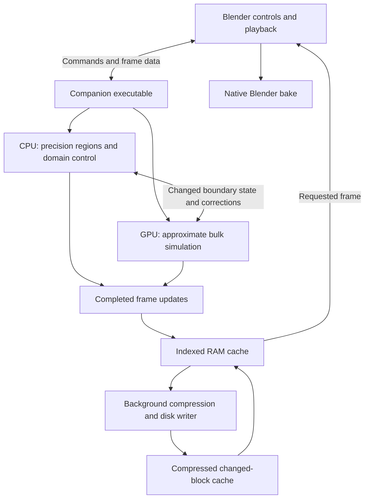
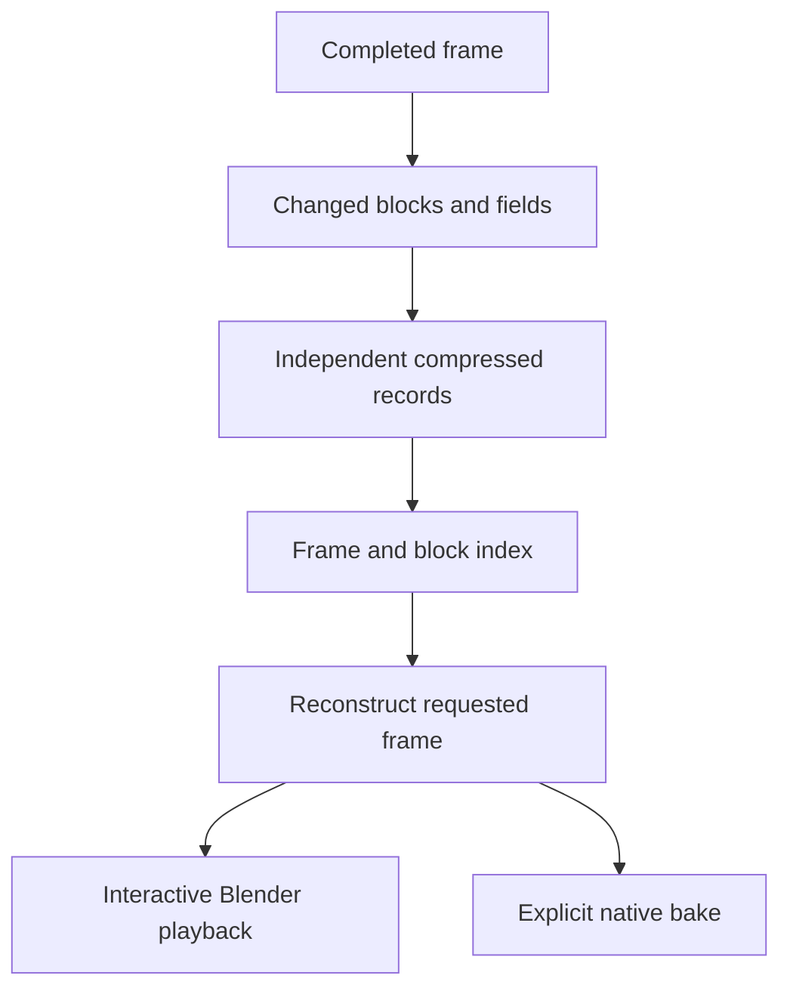

# OpenGrainSim — Scope

## Purpose

OpenGrainSim is an accelerated particle simulation tool for Blender, using a companion executable for computation outside Blender.

Its primary uses are **real-time scrubbing of computed simulation frames** and **baking particle results into Blender's Geometry Nodes / simulation-node workflow**. Materials include grains, liquids and semisolids; implementation can be phased.

Real-time playback is a goal. Real-time computation of every scene is not a guarantee.

This document records the owner's clarified scope. It supersedes conflicting assumptions in earlier planning: an FP32 minimum for all positions, disk files as the live exchange mechanism, and native Blender baking deferred as an optional extra.

## Architecture

## Required behaviour

| Area | Definition |
| --- | --- |
| CPU | Own precision-sensitive regions, surface interactions, accurate calculations and domain control. Solve only active or invalidated regions and their required dependencies. |
| GPU | Keep bulk state resident and perform approximate bulk calculations using the detected GPU's hardware acceleration. |
| Precision | Use the highest hardware-accelerated floating point method supported by the detected GPU. |
| Transfers | Send only changed data needed by the receiving component. Never require a full-domain CPU–GPU round trip each frame. |
| Memory | Retain unchanged state; compact changed particles, fields and blocks into batched updates. |
| Live communication | Exchange commands and playback data through memory-based IPC, rather than continuously writing files for Blender to read. |
| Cache | Record changed domain blocks per frame. Compress and batch disk writes on a worker inside the companion executable. |
| Scrubbing | Seek directly to indexed cached frames, including backwards, with bounded reconstruction work and RAM reuse. |
| Baking | Feed computed geometry and attributes into Blender and produce a native bake through Blender's own evaluation and baking facilities. |

Storage compression is assessed separately from the GPU floating point method. Validate its error against interaction sensitivity and error propagation, and benchmark real kernels and transfers.

## Activity and ownership

- Distinguish **needs solving**, **needs transfer**, and **needs caching**. A changed GPU particle need not be transferred to the CPU solver.
- Wake regions when particles arrive, neighbours change, colliders move, controls change, or solver residuals require work.
- Promote particles before precision-sensitive interactions; use a transition region and hysteresis.
- Assign each interaction one owner. Return reciprocal boundary corrections without duplicating or discarding them.
- Preserve stable particle IDs through sorting, migration and precision changes.
- Expand active regions when dependencies require it. Global pressure solves may prevent strictly local updates.
- Increasing precision cannot recover detail already discarded; bound bulk error before promotion.

## Cache and Blender workflow

Use an initial state, changed-block records and periodic block keyframes. Reuse unchanged blocks and bound delta-chain length so random seeks do not replay the entire simulation.

The writer consumes immutable completed buffers through a bounded queue. If storage falls behind during baking, apply backpressure rather than drop frames. Publish only complete cache records.

Playback data and restart checkpoints are separate: restarting may require velocities, contact history, material state and scheduling data beyond visible geometry.

Blender's native bake is a separate output format. Do not assume it preserves our compression or can directly import our cache. Validate frame feeding, attributes and evaluation order in Blender 5.1. Keep persistent compression and disk threads in the companion, with Blender data updates handled through supported Blender execution paths.

## Method assessment

These are candidate methods, not commitments to a particular library or backend. Existing solver alternatives remain available.

| Method | Assessment | Intended use |
| --- | --- | --- |
| Resident state, dirty blocks and compact transfers | First implementation priority | Reduce bus traffic and unnecessary CPU work before adding complex codecs. |
| [QuanTaichi](https://mingkuan.taichi.graphics/publication/2021-quantaichi/) | Strong fit | Packed low-bit simulation state; evaluate encoding overhead and accuracy. |
| [Automatic Quantization](https://arxiv.org/abs/2207.04658) | Research candidate | Allocate precision using error sensitivity; assess applicability to contact discontinuities. |
| [GPU-native compressed neighbour lists](https://arxiv.org/html/2602.19873v1) | Strong benchmark candidate | Reduce neighbour memory; evaluate cluster overhead on granular and fluid workloads. |
| [ZFP](https://computing.llnl.gov/projects/zfp) | Selective fit | Block-compressed grid/SDF data and cache fields; benchmark particle streams separately. |
| [ndzip-gpu](https://sc21.supercomputing.org/proceedings/tech_paper/tech_paper_pages/pap595.html) | Selective fit | Lossless numerical transfers and checkpoints; evaluate sparse-update effectiveness and platform support. |
| [Progressive particle compression](https://hoang-dt.github.io/) | Playback candidate | Fast coarse reconstruction followed by refinement; preserve IDs and attributes separately as needed. |
| [Regional time stepping](https://yuanming.taichi.graphics/publication/2018-asyncmpm/) | Later scheduling candidate | Reduce work in slowly changing regions; published MPM scheduling requires adaptation for other solvers. |

Use compression on a transfer only when compression, transfer and decompression together outperform the uncompressed path. Support an uncompressed fallback for small or incompressible updates.

## Validation priorities

1. Measure random-seek latency, including Blender geometry updates, against a declared interactive playback target.
2. Measure CPU–GPU bytes, transfer latency and active CPU work as the changed fraction varies.
3. Compare approximate bulk behaviour and precision-region results against a higher-precision reference.
4. Verify boundary ownership, wake propagation, migrations and stable IDs.
5. Verify forward/backward reconstruction, bounded cache memory, cancellation and complete-record recovery.
6. Bake representative frames in Blender 5.1 and verify geometry, attributes and playback after reopening.

No compression ratio, particle count or frame-rate guarantee is established until measured.

## Documentation and repository rules

- Write requested planning documentation directly to `main`.
- Keep source papers out of the repository; commit notes and links only.
- Keep alternative methods rather than removing them as redundant.
- Use concise documentation and flowcharts where they clarify behaviour.
- End every new commit message with exactly: `Written with assistance from machine coding tools.`

## Blender references

- [Bake node: animation support and format limitations](https://docs.blender.org/manual/en/5.1/modeling/geometry_nodes/geometry/operations/bake.html)
- [Simulation bake operators](https://docs.blender.org/api/5.1/bpy.ops.object.html)
- [Python threading restrictions](https://docs.blender.org/api/5.1/info_gotchas_threading.html)
